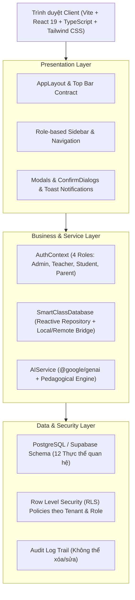

# SMART CLASS – HỆ THỐNG QUẢN LÝ LỚP HỌC THÔNG MINH

Nền tảng quản lý lớp học số thông minh toàn diện, phục vụ 4 vai trò:
1. **Giáo viên (Teacher)**: Quản lý lớp, học sinh, điểm danh, bài tập, chấm điểm, sổ điểm điện tử, trợ lý AI, công cụ lớp học.
2. **Học sinh (Student)**: Xem lịch học, làm quiz, nộp bài tập, tra cứu điểm và chuyên cần cá nhân.
3. **Phụ huynh (Parent)**: Theo dõi con, kết quả học tập, chuyên cần, nhận xét giáo viên và trao đổi trực tiếp với GVCN.
4. **Quản trị viên (Admin)**: Quản trị trường, năm học, khối, phân quyền RBAC, audit log, sao lưu và khôi phục hệ thống.

---

## 1. TÀI KHOẢN TRẢI NGHIỆM DEMO (1-CLICK TEST LOGIN)

Tại màn hình đăng nhập (`/login`), hệ thống tích hợp sẵn 4 thẻ đăng nhập tức thời (1-click) hoặc đăng nhập qua email:

| Vai trò | Họ và tên | Email đăng nhập | Mật khẩu demo | Mô tả & Chức năng chính |
| :--- | :--- | :--- | :--- | :--- |
| **Giáo viên** | Cô Nguyễn Thị Mai | `teacher@smartclass.edu.vn` | `123456` | GVCN Lớp 10A1, Tổ trưởng Toán. Quản lý lớp, điểm danh, sổ điểm, AI hỗ trợ |
| **Quản trị viên** | Thầy Trần Minh Đức | `admin@smartclass.edu.vn` | `123456` | Phó Hiệu trưởng. Quản trị hệ thống, RBAC, audit log, sao lưu |
| **Học sinh** | Nguyễn Hoàng Nam | `student@smartclass.edu.vn` | `123456` | Học sinh Lớp 10A1. Lịch học, nộp bài tập, điểm số cá nhân |
| **Phụ huynh** | Nguyễn Văn Hùng | `parent@smartclass.edu.vn` | `123456` | Phụ huynh em Hoàng Nam. Xem chuyên cần, bảng điểm, trao đổi với GV |

Ngoài ra, trên thanh điều hướng đầu trang (Header) luôn có bộ **Chuyển đổi vai trò tức thì (Role Switcher)** để người đánh giá có thể chuyển đổi qua lại giữa 4 vai trò mà không cần đăng xuất.

---

## 2. KIẾN TRÚC TỔNG THỂ HỆ THỐNG (SYSTEM ARCHITECTURE)



---

## 3. CƠ SỞ DỮ LIỆU & ROW-LEVEL SECURITY (RLS)

File schema SQL hoàn chỉnh nằm tại: `src/sql/schema_and_migration.sql`

Gồm 12 bảng thực thể:
1. `schools` (Trường/Tổ chức)
2. `academic_years` (Năm học)
3. `profiles` (Người dùng & Role enum)
4. `classes` (Lớp học, phòng học, mã tham gia)
5. `students` (Hồ sơ học sinh)
6. `parents` & `student_parents` (Phụ huynh và liên kết con cái)
7. `attendance_sessions` & `attendance_records` (Điểm danh & lý do vắng)
8. `assignments` & `assignment_submissions` (Bài tập & chấm điểm)
9. `student_grades` (Sổ điểm chi tiết hệ số)
10. `behavior_records` (Hành vi & điểm thi đua)
11. `smart_alerts` (Cảnh báo thông minh)
12. `audit_logs` (Nhật ký kiểm toán hệ thống)

Chính sách bảo mật RLS:
- **Teacher**: Chỉ xem và thao tác trên các lớp học mình phụ trách.
- **Student**: Chỉ xem điểm, chuyên cần, bài tập của chính mình; chỉ nộp bài của bản thân.
- **Parent**: Chỉ truy cập dữ liệu của học sinh được liên kết trong bảng `student_parents`.
- **Admin**: Quyền xem toàn trường và truy cập audit logs.

---

## 4. CẤU TRÚC THƯ MỤC NGUỒN (DIRECTORY TREE)

```text
src/
├── components/
│   └── common/             # Breadcrumb, ConfirmDialog, EmptyState, Header, Modal, PageHeader, RoleGuard, Sidebar, StatCard
├── contexts/
│   ├── AuthContext.tsx     # Quản lý người dùng, active class, role switching
│   └── ToastContext.tsx    # Thông báo toast phản hồi thao tác
├── data/
│   └── seedData.ts         # Dữ liệu mẫu chuẩn: Trường, lớp, 30+ học sinh, điểm danh, bài tập, điểm
├── layouts/
│   └── AppLayout.tsx       # Master layout đáp ứng chuẩn Top Bar Contract & Mobile Drawer
├── lib/
│   └── supabase.ts         # Cấu hình cầu nối Supabase
├── pages/
│   ├── admin/
│   │   └── AdminDashboard.tsx      # Quản trị hệ thống, audit trail, sao lưu & khôi phục
│   ├── auth/
│   │   ├── LoginPage.tsx           # 1-Click login theo 4 vai trò & form đăng nhập
│   │   ├── NotFoundPage.tsx        # 404 handler
│   │   └── UnauthorizedPage.tsx    # 403 RLS violation handler
│   ├── parent/
│   │   └── ParentDashboard.tsx     # Child switcher, chuyên cần, bảng điểm, chat với GVCN
│   ├── student/
│   │   └── StudentDashboard.tsx    # Lịch học, bài tập, nộp bài, tra cứu điểm
│   └── teacher/
│       ├── AIAssistantPage.tsx     # Soạn câu hỏi trắc nghiệm, nhận xét học bạ, giáo án CV 5512
│       ├── AlertsPage.tsx          # Xử lý cảnh báo thông minh theo quy trình
│       ├── AnnouncementsPage.tsx   # Đăng tin & theo dõi tỷ lệ đã đọc
│       ├── AssignmentsPage.tsx     # Giao bài & chấm điểm kèm nhận xét
│       ├── AttendancePage.tsx      # Sổ điểm danh trực quan
│       ├── ClassesListPage.tsx     # CRUD lớp học, tìm kiếm, lọc theo khối
│       ├── ClassWorkspacePage.tsx  # Không gian lớp học 8 Tab tập trung
│       ├── GradesPage.tsx          # Sổ điểm điện tử spreadsheet & xuất CSV
│       ├── ReportsPage.tsx         # Báo cáo tổng kết sư phạm & in ấn
│       ├── SchedulePage.tsx        # Thời khóa biểu tuần
│       ├── StudentsPage.tsx        # Hồ sơ học sinh & Wizard import CSV/Excel 3 bước
│       ├── TeacherDashboard.tsx    # Dashboard tổng quan, KPI, tác vụ nhanh
│       └── tools/
│           └── WheelOfFortunePage.tsx # Vòng quay gọi tên may mắn, full màn hình máy chiếu
├── routes/
│   └── index.tsx           # Route mapping đầy đủ theo sitemap
├── services/
│   ├── aiService.ts        # Tích hợp Gemini API và pedagogical engine dự phòng
│   └── db.ts               # Reactive database engine & LocalStorage persistence
├── sql/
│   └── schema_and_migration.sql # Migration SQL & RLS policies
├── types/
│   └── index.ts            # Type definitions toàn bộ hệ thống
├── App.tsx
├── index.css
└── main.tsx
```

---

## 5. HƯỚNG DẪN TRIỂN KHAI & CHẠY THỰC TẾ

### Chạy Local:
```bash
npm install
npm run dev
```
Truy cập: `http://localhost:3000`

### Kiểm tra build:
```bash
npm run lint
npm run build
```
